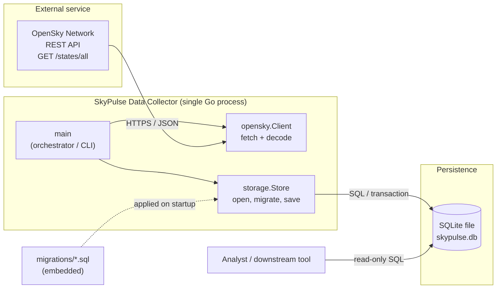

# SkyPulse Data Collector: Final Project Report

**Author:** Abraham Pérez
**Date:** 2026-10-20

## 1. High-level description

SkyPulse is a system for collecting and analyzing live air-traffic data. This
submission covers its **Data Collector (DC)**: a small, self-contained Go program
that periodically pulls a snapshot of every aircraft currently being tracked by
the [OpenSky Network](https://opensky-network.org/) public API and persists it to
a local SQLite database for later querying.

Each run does four things:

1. opens the SQLite database (creating the file on first run),
2. applies any pending schema migrations,
3. fetches one snapshot of aircraft states from `GET /states/all`,
4. stores the snapshot plus one row per aircraft, in a single transaction.

Running it repeatedly (for example from a cron job) builds a time series of
snapshots. The stored data answers questions such as "how many aircraft from
each country were airborne over time" or "where was a given aircraft at each
snapshot", using plain SQL.

The program is intentionally small and operational: no server to run, no external
database to install, and a single dependency (a pure-Go SQLite driver).

A small, stateless web tier (deployed at https://arch3-gilt.vercel.app) renders a
snapshot as an HTML dashboard and a JSON endpoint. It reuses the same OpenSky
client and is read-only; it does not persist anything. See Section 6 for why the
hosted tier is stateless.

## 2. Architecture

### 2.1 Diagram



### 2.2 Processes and services

The collector is a **single process** composed of three cooperating packages.
There is no network service of our own and no message broker; the only remote
service we depend on is OpenSky's REST API.

- **`main` (orchestrator).** Parses command-line flags (`-db`, `-timeout`) and
  optional environment variables (a geographic bounding box), then runs the
  pipeline: open database, migrate, fetch, store, report a count. It owns the
  process lifecycle and the HTTP request timeout via a `context.Context`.

- **`opensky.Client` (acquisition).** Wraps an `http.Client` and calls
  `GET /states/all`. OpenSky returns each aircraft as a *positional, heterogeneous
  JSON array* rather than a labeled object, so the client decodes each row by
  index into a typed `State`, using pointer fields for values OpenSky reports as
  `null`. Malformed rows are skipped rather than failing the whole batch, so one
  bad record never loses an entire snapshot. An optional bounding box restricts
  the query to one region.

- **`storage.Store` (persistence).** Owns the SQLite handle. On startup it applies
  every `migrations/*.sql` file not yet recorded in a `schema_migrations` table,
  inside a transaction, which makes startup idempotent. `SaveSnapshot` writes the
  snapshot header and all its flight-state rows in a **single transaction** using
  a prepared statement, so a snapshot is stored all-or-nothing.

- **Persistence layer.** A SQLite database file. `snapshots` holds one row per
  fetch; `flight_states` holds one row per aircraft in that fetch, linked by a
  foreign key with `ON DELETE CASCADE`. Indexes on `snapshot_id`, `icao24`, and
  `origin_country` support the expected read queries. Any analyst or downstream
  tool reads the file directly with SQL; the collector is write-only to it.

### 2.3 Data flow

OpenSky API `->` HTTPS/JSON `->` `opensky.Client` decodes to `[]State` `->`
`storage.Store` writes one `snapshots` row + N `flight_states` rows in one
transaction `->` SQLite file `->` read-only SQL for analysis.

## 3. Design decisions and justifications

**Language: Go.** A single statically compiled binary with no runtime to install,
first-class HTTP and JSON in the standard library, and `context`-based timeouts
make it a natural fit for a small, scheduled data-collection job.

**Database: SQLite (SQL), not a NoSQL store.** This is the central design choice
the rubric asks about, so the reasoning in full:

- *The data is strongly relational and regular.* Every aircraft state has the same
  fixed set of fields, and each belongs to exactly one snapshot (a clean
  one-to-many relationship). That is precisely what a relational schema with a
  foreign key models best. A document store's flexible, schema-less shape would
  buy us nothing here because the shape never varies.
- *The queries are relational and ad hoc.* The whole point of collecting the data
  is to aggregate and join it later ("count by `origin_country`", "trace one
  `icao24` across snapshots", "join a snapshot to its states"). SQL with
  `GROUP BY`, `JOIN`, and indexes answers these directly; a key-value or document
  store would push that work back into application code.
- *Operational simplicity.* SQLite is an embedded, serverless, single-file
  database. There is nothing to provision, secure, or keep running, which matches
  a lightweight collector better than standing up a MongoDB/Cassandra cluster.
- *A pure-Go driver (`modernc.org/sqlite`) means no CGO and no C toolchain,* so the
  project builds and runs anywhere Go does.
- *When NoSQL would win:* if we needed massive horizontal write scale across many
  nodes, highly variable/unstructured documents, or geo-distributed multi-writer
  ingestion, a NoSQL store (for example Cassandra for write throughput, or a
  time-series database for retention and downsampling) would be the better call.
  At this project's scale (periodic single-writer snapshots on one machine), that
  complexity is not justified. The migration path is deliberately open: the
  `storage` package is the only code that touches the database, so the backend can
  be swapped without changing the collector logic.

**Schema and reliability choices.**

- *Migrations recorded in `schema_migrations`* make startup idempotent: re-running
  never re-applies or double-applies schema changes.
- *Each snapshot is written in one transaction,* so a partial/interrupted run
  never leaves half a snapshot behind.
- *Nullable columns and pointer fields* faithfully preserve the "unknown" that
  OpenSky reports (null position, null callsign), instead of inventing zeros.
- *Migrations are embedded with `go:embed`* so the binary is self-contained, yet
  the SQL files stay readable in `migrations/` for review.

**Resilience choices.**

- *Per-request timeout via `context`* prevents a slow or hung OpenSky call from
  blocking the process forever.
- *Malformed rows are skipped, not fatal,* so one bad record does not discard a
  whole snapshot.

## 4. System requirements and testability

The requirements below are written to be **verifiable**: each one has a concrete
way to confirm it is met. Section 4.2 states how.

### 4.1 Functional requirements

| # | Requirement |
|---|---|
| F1 | The program fetches a snapshot of aircraft states from the OpenSky `/states/all` endpoint. |
| F2 | Each aircraft state is decoded into typed fields, with OpenSky `null` values preserved as "unknown" rather than zero. |
| F3 | A malformed state row is skipped; the rest of the snapshot is still stored. |
| F4 | Each run stores exactly one `snapshots` row and one `flight_states` row per decoded aircraft, linked by `snapshot_id`. |
| F5 | A snapshot is written atomically: either all of its rows are stored, or none are. |
| F6 | Schema migrations are applied on startup and never applied twice (idempotent). |
| F7 | An optional bounding box (four env vars) limits the query to one region. |

### 4.2 How the requirements are testable

| # | How it is verified |
|---|---|
| F1 | Run the program; it logs the number of states fetched and the OpenSky timestamp. End-to-end check against the live API. |
| F2, F3 | **Unit test** of `decodeState`: feed positional rows with nulls and with a malformed/short row, assert the decoded fields and the skip behavior. No network needed. |
| F4, F5 | **Unit test** of `storage` against an in-memory / temp-file SQLite DB: save a snapshot, assert the row counts in both tables and the foreign-key link. |
| F6 | **Unit test** of `Migrate`: run it twice on a fresh DB, assert the migration is recorded once and the second run is a no-op. |
| F7 | **Unit test** of `BBoxFromEnv`: set the four variables and assert `Set == true`; unset one and assert the box is ignored. |

The repository includes unit tests covering F2, F3, F6, and F7, which run offline
(`go test ./...`). F1 is validated by running the collector against the live
OpenSky API.

### 4.3 Non-functional requirements

| # | Requirement | How it is verified |
|---|---|---|
| N1 | Builds with no C toolchain / CGO (pure Go). | `CGO_ENABLED=0 go build ./...` succeeds. |
| N2 | A hung API call cannot block the process indefinitely. | Per-request timeout via `context`; configurable with `-timeout`. |
| N3 | Re-running the program is safe and additive (no duplicate schema, data appended). | Idempotent migrations (F6); each run inserts a new snapshot. |
| N4 | Code passes static checks. | `go vet ./...` and `gofmt -l .` are clean. |

## 5. How to run

```sh
go mod tidy    # first run only
go run .       # fetches one global snapshot into skypulse.db
go test ./...  # runs the offline unit tests
```

Options and example queries are documented in `README.md`.

## 6. Source code and hosting

**Repository:** https://github.com/abrahamperz/skypulse-data-collector
**Hosted live demo:** https://arch3-gilt.vercel.app

Source layout:

- `main.go` : the command-line collector (open DB, migrate, fetch, store)
- `opensky/` : OpenSky API client, decoding, and an embedded sample snapshot
- `internal/storage/` : SQLite access, migrations, snapshot writes
- `web/` : renders a snapshot as HTML or JSON
- `server/` + `cmd/server/` : the HTTP server behind the hosted demo
- `migrations/` : SQL schema

A note on the hosted demo: the core application is the command-line collector,
which persists snapshots to SQLite. The hosted demo is a **stateless** HTTP view
of a snapshot, because the host (Vercel) runs ephemeral serverless instances with
a read-only filesystem and cannot keep a SQLite file. This is exactly the
SQL-vs-serverless trade-off discussed in Section 3: durable, query-friendly
storage belongs in the collector, while the web tier only reads and renders.
OpenSky rate-limits and sometimes blocks datacenter IP ranges (such as Vercel's);
when the live API cannot be reached from the host, the demo falls back to an
embedded sample snapshot and labels the page accordingly, so the URL always shows
the application working end to end.
